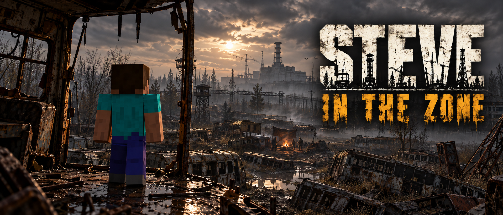

# Steve in the Zone

**Minecraft building and survival in the world of S.T.A.L.K.E.R.**

Windows x64 · Single-player · Survival & Creative

[**Downloads**](https://github.com/DeSoreGD/Steve-in-the-zone/releases) · [Installation guide](README-EN.md) · [Русский](README-RU.md) · [Report a bug](https://github.com/DeSoreGD/Steve-in-the-zone/issues/new/choose)

---

Play as Steve in **S.T.A.L.K.E.R.: Shadow of Chernobyl**. Meet the Zone's original characters, follow its quests, and bring Minecraft tools, armor, crafting and blocks with you.

You play in the S.T.A.L.K.E.R. window. A separate Minecraft instance runs in the background and handles Steve and Minecraft mechanics. The launcher starts and closes both parts together.

## Before you start

These instructions describe **0.4.0-beta.3**, currently prepared for release. Published builds are listed in [Releases](https://github.com/DeSoreGD/Steve-in-the-zone/releases).

| You need | Details |
|---|---|
| Windows | Windows 10 or 11, **64-bit** |
| S.T.A.L.K.E.R. | Installed **Shadow of Chernobyl 1.0006**, without other mods |
| Minecraft | **Java Edition** and its data folder; Bedrock Edition is unsupported |
| Java | **64-bit Java 17+**; Java 21 is recommended for a new installation |
| Internet & storage | Internet for setup downloads and room for separate game files |

Java runs the Minecraft part. If setup finds compatible Java, use it. Otherwise, install [Microsoft OpenJDK 21](https://learn.microsoft.com/en-us/java/openjdk/download#openjdk-21), choosing **Windows → x64 → msi**. The base games and Java are not included in the download.

## Install and play

1. Download the **Windows-x64.zip** from [Releases](https://github.com/DeSoreGD/Steve-in-the-zone/releases). The `sources.zip` is for developers.
2. Extract the **entire archive** and open **`InstallSteveInTheZone.exe`**. Keep the EXE, `_internal` and `payload` together.
3. Select your SoC folder, Minecraft data folder, Java if needed, and a new installation location. Leave **Create a desktop shortcut** checked if you want one.
4. After setup finishes, use the shortcut or open **`app\SteveInTheZone.exe`** in the new **`Steve in the Zone`** folder. Choose **Survival** or **Creative** and launch.

Setup prepares its own **Minecraft 1.20.1 + Fabric** copy inside that installation. It copies matching files from your Minecraft folder and downloads missing components from official Minecraft/Mojang and Fabric servers. **You do not need to install 1.20.1 or Fabric in your regular Minecraft launcher.**

Your Minecraft data folder is usually `%APPDATA%\.minecraft`; other launchers may use a different folder. [Detailed installation guide](README-EN.md).

## Updating an existing installation

Close the game and its launcher. Open the new Setup, select **Update existing and keep progress**, and choose the existing **Steve in the Zone** folder. Setup replaces the project files and keeps your worlds, joint saves, inventory, player identity and settings. Replaced files are backed up in `update-backups` inside that installation. Custom development layouts are not supported by this update mode.

## Essential controls

| Key | Action |
|---|---|
| WASD / Space | Move / jump |
| E | Minecraft inventory and access to Zone items |
| G | Talk and interact |
| F5 | Third-person view |
| F6 | Switch Survival / Creative |
| F7 / F8 | Save / load both parts together |
| Esc | Menu and graphics settings |

[All controls and F9 obstacle escape](README-EN.md#controls).

## Your files and the source code

Setup creates a **separate installation**. Your original games and saves stay in their original folders. Launcher accounts, login tokens and existing worlds are not imported. This beta uses a local player nickname; no account sign-in is required.

Both game processes, their settings, logs and new saves belong to the new installation. The background Java/Minecraft process is part of the game.

The [launcher folder](launcher) contains the installer and launch application. The release `sources.zip` also contains the Minecraft mod, native engine changes and bridge code.

[Code license and permitted uses](LICENSING.md) · [File handling, download sources and executable signatures](SECURITY.md) · [Build from source](BUILD-SOURCES.md) · [Component licenses](https://github.com/DeSoreGD/Steve-in-the-zone/tree/main/licenses)

## Beta scope

A complete playthrough of the original campaign has **not yet been confirmed**. Progression bugs may occur. Use Minecraft equipment for combat and protection: SoC guns, outfit protection and artifact effects are not fully integrated. Microsoft sign-in and multiplayer are not implemented.

[Known limitations](KNOWN-LIMITATIONS.md) · [Bug reports and useful logs](REPORT-A-PROBLEM.md)

